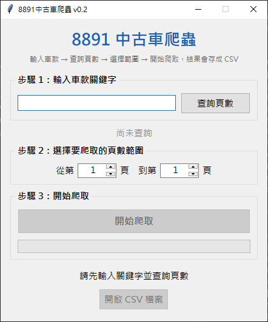

# 8891 中古車爬蟲

輸入車款關鍵字，把 [8891 中古車網](https://auto.8891.com.tw/) 的搜尋結果整理成 CSV 檔，可以用 Excel 開啟比較價格、里程和年份。

> 聯成電腦 Python 課程的練習作品，一年後重新優化的版本。



## 功能

- 視窗介面，照「步驟 1 → 2 → 3」操作，不用寫程式
- 先查詢總頁數，再選擇要抓的頁數範圍
- 多執行緒同時抓取多頁，進度條顯示目前進度
- 自動去除重複的車輛（置頂廣告會出現在多頁）
- 支援中文關鍵字，例如「豐田」

CSV 欄位：標題、縣市、價格、里程、年份、圖片連結、超連結、內文

---

## 安裝

### 1. 事前準備

| 項目 | 說明 |
|---|---|
| **Python 3.9 以上** | 到 [python.org](https://www.python.org/downloads/) 下載，或安裝 [Anaconda](https://www.anaconda.com/download) |
| **Google Chrome** | 程式透過 Chrome 開啟網頁抓資料，一定要安裝 |

> 不需要自己下載 chromedriver，第一次執行時會自動下載符合 Chrome 版本的 driver（需要網路）。

### 2. 下載專案

```
git clone https://github.com/tedchen05/8891-car-crawler.git
cd 8891-car-crawler
```

或在 GitHub 頁面按綠色的 **Code** → **Download ZIP**，下載後解壓縮。

### 3. 安裝套件

在專案資料夾開啟終端機，執行：

```
pip install -r requirements.txt
```

> 使用 Anaconda 的話，請在「Anaconda Prompt」中執行。

---

## 執行

### 方法一：終端機

```
python gui_thread.py
```

### 方法二：VS Code 按 F5

1. 用 VS Code 開啟專案資料夾（第一次開啟時，右下角會建議安裝 Python 擴充功能，按「安裝」）
2. 按 `Ctrl + Shift + P`，輸入 `Python: Select Interpreter`，選擇**有安裝上述套件的 Python**
3. 按 **F5**

在「執行與偵錯」面板（`Ctrl + Shift + D`）上方可以切換：

| 選項 | 作用 |
|---|---|
| 執行爬蟲GUI | 開啟視窗介面（預設） |
| 執行目前開啟的檔案 | 執行目前正在編輯的檔案 |

---

## 使用方式

1. **步驟 1**：輸入車款關鍵字（例如 `jimny`），按「**查詢頁數**」或直接按 Enter
2. **步驟 2**：查到頁數後會自動填入「從第 1 頁到最後一頁」，可自行調整範圍
3. **步驟 3**：按「**開始爬取**」，等進度條跑完
4. 完成後按「**開啟 CSV 檔案**」，或到「**下載**」資料夾找 `8891_關鍵字.csv`

> 每頁約 40 筆，每頁大約需要 5～10 秒。

---

## 可調整的設定

| 檔案 | 位置 | 說明 |
|---|---|---|
| `gui_thread.py` | `MAX_WORKERS=5` | 同時爬取的頁數上限。電腦較慢可以改小 |
| `gui_thread.py` | `SAVE_DIR` | CSV 存檔資料夾，預設為「下載」 |
| `gui_thread.py` | `FONT` | 介面字型，Mac 可改成 `"PingFang TC"` |
| `car_8891_thread.py` | `get_chrome()` 的 `hide=True` | 改成 `False` 可以看到瀏覽器實際操作畫面，除錯時好用 |

---

## 已知限制

- **網站改版可能失效**：爬蟲依賴網頁結構，8891 改版後需要修改 `car_8891_thread.py` 中的選擇器（`select` / `select_one` 那幾行）

---

## 常見問題

**Q：VS Code 在 `import selenium` 底下畫波浪線，顯示「無法解析匯入」？**
VS Code 選到的 Python 沒有安裝套件。照「方法二」重新選擇 Python，或對目前的 Python 執行 `pip install -r requirements.txt`。

**Q：出現 `ModuleNotFoundError: No module named 'selenium'`？**
同上，執行用的 Python 和安裝套件的不是同一個。

**Q：第一次執行很久，或出現 chromedriver 相關錯誤？**
第一次會自動下載 chromedriver，需要網路，請稍等。並確認電腦已安裝 Google Chrome。

**Q：狀態顯示「CSV 檔案正被 Excel 開啟」？**
上一次的 CSV 還開在 Excel 裡，關閉後再按一次「開始爬取」。

**Q：狀態顯示「查無資料」？**
8891 上找不到符合的車輛，換個關鍵字試試。如果網站上明明有資料，可能是網站改版，請參考「已知限制」。

---

## 檔案說明

```
8891-car-crawler/
├── gui_thread.py          # 視窗介面（主程式，執行這個）
├── car_8891_thread.py     # 爬蟲核心：開啟網頁、解析資料
├── requirements.txt       # 需要安裝的套件
├── images/
│   └── screenshot.png     # 介面截圖
└── .vscode/
    ├── launch.json        # VS Code 按 F5 的執行設定
    └── extensions.json    # 建議安裝的 VS Code 擴充功能
```

## 注意事項

本專案僅供學習 Python 爬蟲使用。請勿短時間大量抓取，以免造成網站負擔；資料版權屬於 8891 及刊登者所有，使用時請遵守網站的使用條款。
